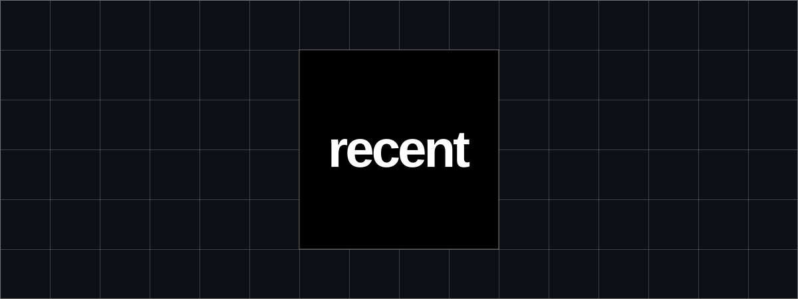

<p align="center">
  
</p>

<h1 align="center">Recent</h1>

<p align="center">Keeps you current on AI.</p>

<p align="center">
  <a href="#introduction">Introduction</a> ·
  <a href="#tech-stack">Tech stack</a> ·
  <a href="docs/development.md">Local setup</a> ·
  <a href="docs/deployment.md">Self-hosting</a> ·
  <a href="CONTRIBUTING.md">Contributing</a> ·
  <a href="SECURITY.md">Security</a>
</p>

<p align="center">
  <a href="https://github.com/toovinod/recent/actions/workflows/ci.yml"></a>
  <a href="LICENSE"></a>
</p>

## Introduction

Recent is an open-source AI news feed. It collects updates from reviewed sources, groups related coverage into story threads, and shows short posts with links and attribution.

Readers can follow a story as it develops. Posts and reactions come from sources; readers do not publish posts or comments.

RSS, Atom, X timelines, and X conversation searches are implemented. The project is under active development. Source coverage depends on API access, polling intervals, and budgets.

## Tech stack

- [Next.js](https://nextjs.org/) and [React](https://react.dev/) for the web app
- [Bun](https://bun.sh/) and [Hono](https://hono.dev/) for the API and worker runtime
- [PostgreSQL](https://www.postgresql.org/) and [Kysely](https://kysely.dev/) for persistence
- [Redis](https://redis.io/) and [BullMQ](https://docs.bullmq.io/) for caching and jobs
- [Better Auth](https://www.better-auth.com/) and [Resend](https://resend.com/) for authentication and email
- [TypeSafe](https://docs.typesafe.ai/) and the OpenAI API for classification, matching, and excerpt selection
- [Tailwind CSS](https://tailwindcss.com/), [Biome](https://biomejs.dev/), and [Turborepo](https://turbo.build/) for styling and tooling

## Development

Start with the [local setup guide](docs/development.md). You will need Bun 1.4.2, PostgreSQL, Redis, and a Resend account for authentication emails. Running ingestion also requires model provider credentials.

```sh
bun install --frozen-lockfile
bun run dev
```

Configure the environment and apply database migrations before starting the applications. No sources are registered automatically.

## Documentation

- [Architecture](ARCHITECTURE.md): components, data flow, and ownership
- [Self-hosting](docs/deployment.md): configuration, migrations, and deployment checks
- [Operations](docs/operations.md): recovery, editorial actions, budgets, and metrics
- [Contributing](CONTRIBUTING.md): changes, tests, and pull requests
- [Security](SECURITY.md): supported code and private vulnerability reports

## License

[Apache 2.0](LICENSE). Source material remains subject to its owners' rights and access terms.
